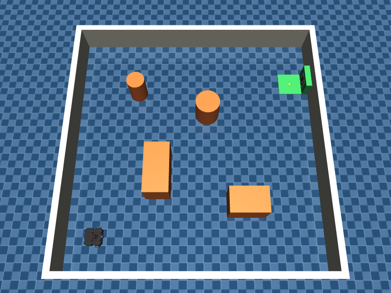

# 41014 Integrated Project

Track A: mobile robot visual waypoint navigation. A TurtleBot3 Waffle Pi in MuJoCo navigates a room with obstacles using its 2D LiDAR and docks at an ArUco-marked charging station. The pipeline is a state-space model of the platform, an EKF fusing wheel-encoder odometry with camera measurements of the marker, and an LQR trajectory tracker that uses only the estimated state.



## Group Information

Project number: 38

| Name | Student ID |
|---|---|
| Benedict Valdez | 25470271 |
| Jacob Jung | 25469949 |

## Install Info

Tested with Python 3.10 or newer.

```
git clone https://github.com/benedictavaldez-ai/41014-Integrated-Project.git
cd 41014-Integrated-Project
python -m venv .venv
```

Activate the environment:

- Windows: `.venv\Scripts\activate`
- macOS / Linux: `source .venv/bin/activate`

Then install the dependencies:

```
pip install -r requirements.txt
```

## Run Commands

Sensor smoke test with the MuJoCo viewer (drives an open-loop path and prints encoder, LiDAR and ArUco readings):

```
python main.py
```

Same test without the viewer:

```
python main.py --headless
```

Controllability and observability check:

```
python analysis/model_check.py
```

## Repository Structure

```
models/
  turtlebot3/        unmodified ROBOTIS TurtleBot3 MJCF and meshes (Apache 2.0)
  tb3_robot.xml      Waffle Pi with camera, LiDAR site and wheel encoders added
  world.xml          room, obstacles, charging dock with ArUco marker
  textures/          ArUco marker image (DICT_4X4_50, id 0)
src/
  perception/        LiDAR ray-cast scanner, ArUco detection and pose
  estimation/        EKF (step 2)
  control/           LQR tracker and docking (step 3)
analysis/            model checks and evaluation scripts
main.py
```

## Simulation Setup

| Item | Value |
|---|---|
| Room | 4 m x 4 m, walls 0.5 m high, four obstacles |
| Start pose | (-1.5, -1.5, 0) |
| Charging dock | marker centre at (1.899, 1.2, 0.13), facing -x, docking point at (1.70, 1.2) |
| Physics timestep | 2 ms |
| Wheel motors | velocity actuators, kv = 1, limit ±7.88 rad/s |
| Camera | 640 x 480, vertical FOV 48.8°, 0.086 m ahead of the wheel axle, 0.107 m high |
| LiDAR | 360 beams, 0.12 to 3.5 m, 0.172 m high, σ = 0.01 m |
| Encoders | wheel joint angle, read every control step |

Changes made to the ROBOTIS model, and why:

- The chassis collision mesh touches the floor and was dragging with full friction, so the robot only reached about 50% of the commanded speed and could not turn in place. The chassis contact is now frictionless (it behaves like the real ball casters).
- The wheel velocity gain was raised from 0.1 to 1. With 0.1 the wheels reached only about 75% of the commanded speed because of joint friction. With 1 they reach about 97%.
- The original model has no camera, LiDAR or encoder sensors, so these were added at the positions of the real Raspberry Pi camera and LDS-01.

## Model

State and input:

$$x = \begin{bmatrix} p_x & p_y & \theta \end{bmatrix}^T, \qquad u = \begin{bmatrix} v & \omega \end{bmatrix}^T$$

Differential-drive kinematics (unicycle), with wheel radius r = 0.033 m and wheel separation b = 0.288 m:

$$\dot p_x = v\cos\theta, \quad \dot p_y = v\sin\theta, \quad \dot\theta = \omega$$

$$v = \frac{r(\omega_R + \omega_L)}{2}, \qquad \omega = \frac{r(\omega_R - \omega_L)}{b}$$

Assumptions: no wheel slip, flat floor, motor dynamics fast compared with the controller. The smoke test confirms the first and third: commanding v = 0.15 m/s gives 0.146 m/s, and commanding ω = 0.5 rad/s gives 0.474 rad/s with wheel speeds that match the kinematics exactly.

Discrete-time model used by the EKF (Euler, Δt):

$$x_{k+1} = x_k + \Delta t \begin{bmatrix} v_k\cos\theta_k \\ v_k\sin\theta_k \\ \omega_k \end{bmatrix}, \qquad F_k = \begin{bmatrix} 1 & 0 & -v_k\Delta t\sin\theta_k \\ 0 & 1 & v_k\Delta t\cos\theta_k \\ 0 & 0 & 1 \end{bmatrix}$$

Tracking-error model used by the LQR, linearised about a reference (v_r, ω_r) with the error expressed in the robot frame:

$$\dot e = \begin{bmatrix} 0 & \omega_r & 0 \\ -\omega_r & 0 & v_r \\ 0 & 0 & 0 \end{bmatrix} e + \begin{bmatrix} 1 & 0 \\ 0 & 0 \\ 0 & 1 \end{bmatrix} \delta u$$

### Controllability

Output of `python analysis/model_check.py`:

| Reference | Rank of controllability matrix |
|---|---|
| v_r = 0.2, ω_r = 0 | 3 (controllable) |
| v_r = 0.2, ω_r = 0.5 | 3 (controllable) |
| v_r = 0, ω_r = 0.5 | 3 (controllable) |
| v_r = 0, ω_r = 0 | 2 (not controllable) |

When the reference is stationary, the linearised model cannot correct sideways error, because the robot cannot move sideways. The tracker therefore always follows a moving reference, and the final docking alignment is done by driving through a path rather than by regulating to a point.

### Observability

| Measurement | Rank of observability matrix |
|---|---|
| Wheel odometry only | 0 (absolute pose unobservable, error grows without bound) |
| Range + bearing to one marker, any motion | 2 |
| Full marker pose from PnP, one frame | 3 |

Range and bearing to a single landmark leave one direction unobservable: rotating the robot's whole path about the marker produces identical measurements. The EKF therefore uses the full marker pose from PnP (which also gives heading), or range and bearing to two or more markers.
