# 41014 Integrated Project

Track A: mobile robot visual waypoint navigation. A TurtleBot3 Waffle Pi in MuJoCo navigates a room with obstacles using its 2D LiDAR and docks at an ArUco-marked charging station. The pipeline is a state-space model of the platform, an EKF fusing wheel-encoder odometry with camera measurements of the marker, and an LQR trajectory tracker that uses only the estimated state.

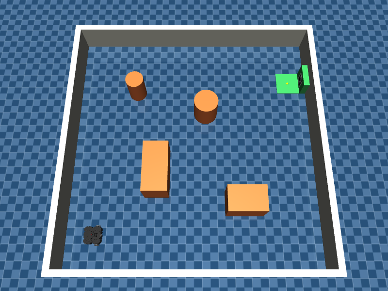

## Group Information

Project number: 38

| Name | Student ID |
|---|---|
| Benedict Valdez | 25470271 |
| Jacob Jung | 25469949 |

## Install Info

Tested with Python 3.10 or newer.

```
git clone https://github.com/benedictavaldez-ai/41014-Integrated-Project.git
cd 41014-Integrated-Project
python -m venv .venv
```

Activate the environment:

- Windows: `.venv\Scripts\activate`
- macOS / Linux: `source .venv/bin/activate`

Then install the dependencies:

```
pip install -r requirements.txt
```

## Run Commands

Sensor smoke test with the MuJoCo viewer (drives an open-loop path and prints encoder, LiDAR and ArUco readings):

```
python main.py
```

Same test without the viewer:

```
python main.py --headless
```

Controllability and observability check:

```
python analysis/model_check.py
```

Marker measurement noise study (writes `docs/marker_noise.png`):

```
python analysis/marker_noise.py
```

EKF test on the open-loop path (writes `docs/ekf_open_loop.png`):

```
python analysis/ekf_open_loop.py
```

Same test with a random initial estimate error (writes `docs/ekf_open_loop_init_seed3.png`):

```
python analysis/ekf_open_loop.py --init-error --seed 3
```

Closed-loop test, EKF + LQR from start to dock (writes `docs/tracking.png`):

```
python analysis/tracking_test.py
```

Same test with a random initial estimate error (writes `docs/tracking_init_seed3.png`):

```
python analysis/tracking_test.py --init-error --seed 3
```

Full pipeline from start to dock, scored against ground truth (writes `docs/run_<scenario>.png`):

```
python run.py --scenario nominal --viewer
```

Scenarios: `nominal`, `odom_bias`, `push`, `occlusion`, `all`. `--viewer` opens the MuJoCo viewer in real time, `--init-error` starts with a wrong estimate, `--seed` sets the random seed.

Repeated randomised trials (writes `analysis/results/trials.csv` and `docs/trials.png`):

```
python analysis/trials.py --trials 10 --jobs 2
```

LQR and EKF trade-off sweeps (writes `analysis/results/sweeps.csv`, `docs/sweep_lqr.png`, `docs/sweep_ekf.png`; `--plot-only` redraws the plots from the saved CSV):

```
python analysis/sweeps.py --jobs 2
```

Each run renders the camera at 10 Hz and takes about 1 to 2 minutes on a CPU; `--jobs` sets how many runs go in parallel.

## Repository Structure

```
models/
  turtlebot3/        unmodified ROBOTIS TurtleBot3 MJCF and meshes (Apache 2.0)
  tb3_robot.xml      Waffle Pi with camera, LiDAR site and wheel encoders added
  world.xml          room, obstacles, charging dock with ArUco marker
  textures/          ArUco marker image (DICT_4X4_50, id 0)
src/
  perception/        LiDAR ray-cast scanner, ArUco detection and pose,
                     wheel encoders, marker measurement and noise model
  estimation/        EKF
  control/           reference trajectory, LQR tracker, LiDAR speed limit
  pipeline.py        full robot loop and state machine
  scenarios.py       disturbances: odometry bias, push, camera occlusion
analysis/            model checks, sensor calibration, EKF and tracking tests,
                     repeated trials and trade-off sweeps
  results/           trial and sweep results (CSV)
docs/                figures and the project page
run.py               entry point: run a scenario, score it against ground truth, plot it
main.py              sensor smoke test
```

Simulator ground truth is read only in `analysis/` and in the evaluation-only observer in `run.py`; nothing in `src/` uses it.

## Simulation Setup

| Item | Value |
|---|---|
| Room | 4 m x 4 m, walls 0.5 m high, four obstacles |
| Start pose | (-1.5, -1.5, 0) |
| Charging dock | marker centre at (1.899, 1.2, 0.13), facing -x, docking point at (1.70, 1.2) |
| Physics timestep | 2 ms |
| Wheel motors | velocity actuators, kv = 1, limit ±7.88 rad/s |
| Camera | 640 x 480, vertical FOV 48.8°, 0.086 m ahead of the wheel axle, 0.107 m high |
| LiDAR | 360 beams, 0.12 to 3.5 m, 0.172 m high, σ = 0.01 m |
| Encoders | wheel joint angle quantised to 4096 ticks/rev (Dynamixel XM430), read every 20 ms |

Changes made to the ROBOTIS model, and why:

- The chassis collision mesh touches the floor and was dragging with full friction, so the robot only reached about 50% of the commanded speed and could not turn in place. The chassis contact is now frictionless (it behaves like the real ball casters).
- The wheel velocity gain was raised from 0.1 to 1. With 0.1 the wheels reached only about 75% of the commanded speed because of joint friction. With 1 they reach about 97%.
- The original model has no camera, LiDAR or encoder sensors, so these were added at the positions of the real Raspberry Pi camera and LDS-01.

## Model

State and input:

$$x = \begin{bmatrix} p_x & p_y & \theta \end{bmatrix}^T, \qquad u = \begin{bmatrix} v & \omega \end{bmatrix}^T$$

Differential-drive kinematics (unicycle), with wheel radius r = 0.033 m and wheel separation b = 0.288 m:

$$\dot p_x = v\cos\theta, \quad \dot p_y = v\sin\theta, \quad \dot\theta = \omega$$

$$v = \frac{r(\omega_R + \omega_L)}{2}, \qquad \omega = \frac{r(\omega_R - \omega_L)}{b}$$

Assumptions: no wheel slip, flat floor, motor dynamics fast compared with the controller. The smoke test confirms the first and third: commanding v = 0.15 m/s gives 0.146 m/s, and commanding ω = 0.5 rad/s gives 0.474 rad/s with wheel speeds that match the kinematics exactly.

Discrete-time model used by the EKF, driven by the measured wheel-angle changes Δφ_L, Δφ_R over each 20 ms step (midpoint rule):

$$\Delta s = \frac{r(\Delta\phi_R + \Delta\phi_L)}{2}, \qquad \Delta\theta = \frac{r(\Delta\phi_R - \Delta\phi_L)}{b}, \qquad \theta_m = \theta_k + \frac{\Delta\theta}{2}$$

$$x_{k+1} = x_k + \begin{bmatrix} \Delta s\cos\theta_m \\ \Delta s\sin\theta_m \\ \Delta\theta \end{bmatrix}, \qquad F_k = \begin{bmatrix} 1 & 0 & -\Delta s\sin\theta_m \\ 0 & 1 & \Delta s\cos\theta_m \\ 0 & 0 & 1 \end{bmatrix}$$

Tracking-error model used by the LQR, linearised about a reference (v_r, ω_r) with the error expressed in the robot frame:

$$\dot e = \begin{bmatrix} 0 & \omega_r & 0 \\ -\omega_r & 0 & v_r \\ 0 & 0 & 0 \end{bmatrix} e + \begin{bmatrix} 1 & 0 \\ 0 & 0 \\ 0 & 1 \end{bmatrix} \delta u$$

### Controllability

Output of `python analysis/model_check.py`:

| Reference | Rank of controllability matrix |
|---|---|
| v_r = 0.2, ω_r = 0 | 3 (controllable) |
| v_r = 0.2, ω_r = 0.5 | 3 (controllable) |
| v_r = 0, ω_r = 0.5 | 3 (controllable) |
| v_r = 0, ω_r = 0 | 2 (not controllable) |

When the reference is stationary, the linearised model cannot correct sideways error, because the robot cannot move sideways. The tracker therefore always follows a moving reference, and the final docking alignment is done by driving through a path rather than by regulating to a point.

### Observability

| Measurement | Rank of observability matrix |
|---|---|
| Wheel odometry only | 0 (absolute pose unobservable, error grows without bound) |
| Range + bearing to one marker, any motion | 2 |
| Full marker pose from PnP, one frame | 3 |

Range and bearing to a single landmark leave one direction unobservable: rotating the robot's whole path about the marker produces identical measurements. The EKF therefore adds the robot heading from the full PnP marker pose to the range and bearing measurement, which makes the pose observable from a single marker.

## Sensing

### Marker measurement

Each ArUco detection gives the EKF three numbers, z = [range, bearing, robot heading]:

- Range and bearing come from the PnP translation: range = |t|, bearing = -atan2(t_x, t_z).
- Robot heading comes from the full marker pose, chained through the frames:

$$T_{world,base} = T_{world,marker} \cdot T_{cam,marker}^{-1} \cdot T_{base,cam}^{-1}$$

Frames: world (x east, y north, z up), base (x forward, y left, z up, origin at the wheel axle), camera (OpenCV: x right, y down, z forward, 0.086 m ahead and 0.107 m above the base), marker (x right, y up, z out of the face). The camera transform was checked against MuJoCo's camera pose numerically.

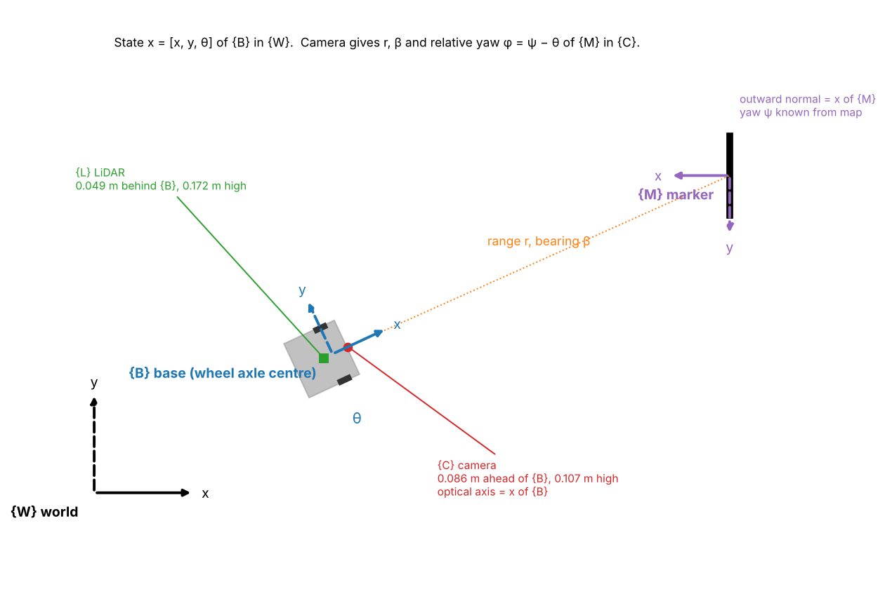

### Calibration

Output of `python analysis/marker_noise.py`: 400 random poses facing the marker, detector output compared with simulator ground truth (0.45 to 4.2 m).

| Quantity | Bias | Noise (std) | Value used in the EKF |
|---|---|---|---|
| Range | reads long by 0.0088 r² | 0.0042 r² | bias removed with k = 0.009, σ = 0.005 r² |
| Bearing | +0.056° | 0.022° | σ = 0.1° |
| Robot heading from PnP | none | 0.94° per m (robust); 11% of readings off by more than 10° | σ = max(1°, 0.9° r), own gate |

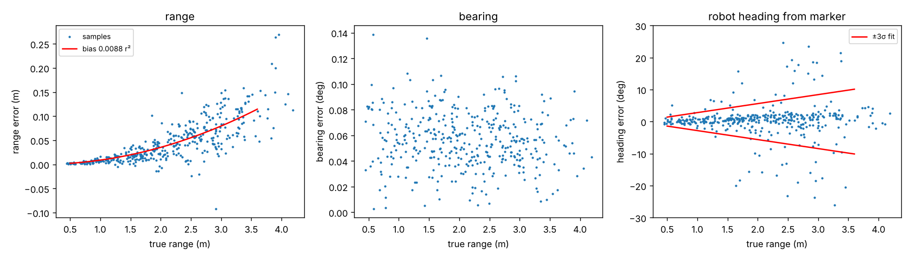

- Range error grows with r² because range comes from the marker's size in pixels (w = fL / r). The fit corresponds to a corner error of about 0.33 px.
- The bearing offset is half a pixel, from the principal point at 320 px instead of 319.5 px.
- Heading is poorly defined at range and suffers from the planar PnP ambiguity (two tilts fit a face-on square almost equally well), which causes the 10 to 30° outliers.
- Ground truth is used here only for offline calibration. The filter uses the resulting constants and never reads ground truth at run time.

## Estimation

### EKF design

| Item | Value |
|---|---|
| State | x = [p_x, p_y, θ] |
| Prediction | encoder wheel-angle changes every 20 ms, midpoint unicycle model |
| Process noise | per wheel σ = 0.02 \|Δφ\| + 10⁻⁴ rad, mapped to the state through the wheel Jacobian |
| Update | every 100 ms when a marker is detected: range + bearing first, then heading as a separate update |
| Measurement noise | calibration values above × 3 |
| Gates | NIS < 9.21 for range + bearing (χ², 2 dof, 99%), NIS < 6.63 for heading (1 dof, 99%) |
| Covariance update | Joseph form |
| Initial covariance | σ = 0.05 m, 0.05 m, 3° |

Range and bearing are accurate, heading is not, so they are updated separately: a rejected heading does not discard a good range and bearing.

### Measurement noise inflation

With the calibrated noise the filter was overconfident, because consecutive frames see almost the same image and their errors are correlated rather than independent. R was inflated and the factor chosen on NEES over 6 seeded runs with a random initial error:

| Inflation | Mean NEES (ideal 3) | Position RMSE | Heading RMSE |
|---|---|---|---|
| 1× | 15.6 | 0.039 m | 0.83° |
| 2× | 5.3 | 0.033 m | 0.71° |
| 3× (used) | 3.5 | 0.032 m | 0.65° |

### Results on the open-loop path

Output of `python analysis/ekf_open_loop.py` (with and without `--init-error`). The marker is first seen at t = 7.5 s.

| Run | Final position error | Final heading error | Position RMSE | Mean NEES |
|---|---|---|---|---|
| Nominal, EKF | 0.005 m | +0.30° | 0.012 m | 1.08 |
| Nominal, odometry only | 0.011 m | +0.05° | | |
| Initial error (seed 3), EKF | 0.011 m | +0.70° | 0.067 m | 9.41 |
| Initial error (seed 3), odometry only | 0.282 m | +6.17° | | |
| Initial error, mean of 6 seeds, EKF | 0.007 m | | 0.032 m | 3.47 |

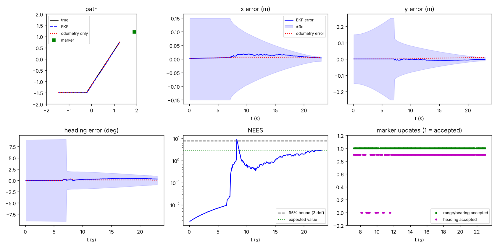

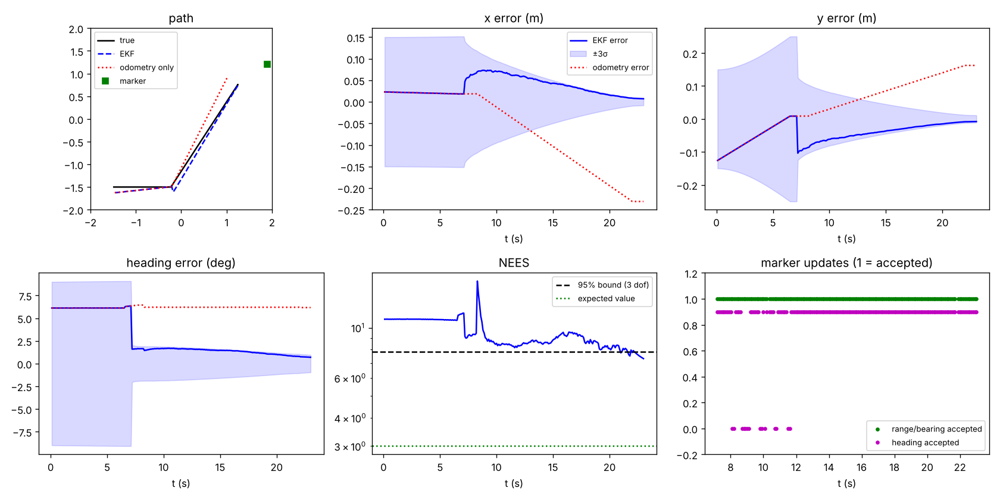

- Simulated odometry is close to perfect (11 mm drift over about 7 m), so the nominal run shows little difference between EKF and odometry. The initial-error run shows the correction: odometry keeps a 6.2° heading error and drifts 28 cm, the EKF ends at 1.1 cm and 0.7°.
- All range and bearing updates pass the gate. 9% of heading updates are rejected, all at long range.
- Seed 3 starts with a 6° heading error (a 2σ draw) and its heading converges slowly, sitting at the edge of the 3σ band for about 10 s. With a single marker, heading is weakly observable and the heading reading is noisy at 3 m.

## Control

### Reference trajectory

Hand-placed waypoints joined by circular fillets (R = 0.30 m), so the robot never has to stop and turn on the spot, which is the uncontrollable case (v_r = 0). The path keeps at least 0.34 m from every obstacle and ends with a straight 0.4 m approach along y = 1.2 into the docking point (1.70, 1.20) facing +x.

| Waypoint (m) | Purpose |
|---|---|
| (-1.50, -1.50) | start |
| (0.05, -1.50) | below box 1 |
| (0.05, -0.20) | centre of the gap between box 1 and box 2 |
| (0.90, 0.45) | past the cylinder at (0.2, 0.6) |
| (1.05, 1.20) | onto the dock centre line |
| (1.70, 1.20) | docking point |

Speed: 0.15 m/s cruise, 0.08 m/s for the last 0.5 m, acceleration and braking limited to 0.10 m/s². Path length 5.10 m, duration 38.1 s, resampled every 20 ms into [x_r, y_r, θ_r, v_r, ω_r].

### LQR tracker

The tracking error is expressed in the robot frame (along-track, lateral, heading) using the EKF estimate, and the command is feedforward plus LQR correction:

$$v = v_r \cos e_3 + K_1 e, \qquad \omega = \omega_r + K_2 e$$

| Item | Value |
|---|---|
| Model | tracking-error model above, discretised with Δt = 20 ms |
| Q (Bryson) | 1 / (0.10 m, 0.05 m, 10°)² |
| R (Bryson) | 1 / (0.10 m/s, 0.50 rad/s)² |
| Gain scheduling | DARE re-solved every step for the current (v_r, ω_r), doubling algorithm, < 1 ms |
| Linearisation floor | v_r ≥ 0.05 m/s in the model (lateral error is uncontrollable at v_r = 0) |
| Wheel saturation | v and ω scaled together if a wheel exceeds 7.88 rad/s (keeps path curvature) |

Example gain on a straight at v_r = 0.15 m/s: K = [[0.99, 0, 0], [0, 9.67, 3.27]]. Along-track error is corrected by speed, lateral and heading error by turn rate.

### LiDAR speed limit

Forward speed is capped by the closest LiDAR return within ±30° of straight ahead: no cap above 0.35 m, linear down to zero at 0.18 m (distances from the LiDAR). The cap only slows the robot; it never steers.

### Results

Output of `python analysis/tracking_test.py` (with and without `--init-error`). Tracking errors compare the true pose with the reference while the reference is moving; docking error is the true final pose against (1.70, 1.20, 0°).

| Run | Along RMSE | Lateral RMSE (max) | Heading RMSE | Docking error | Peak wheel speed |
|---|---|---|---|---|---|
| Nominal | 0.009 m | 0.004 m (0.012 m) | 0.54° | 0.005 m, +0.09° | 7.47 rad/s |
| Initial error (seed 3) | 0.021 m | 0.029 m (0.053 m) | 3.61° | 0.005 m, -0.22° | 7.75 rad/s |

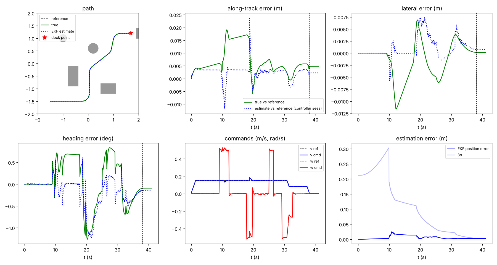

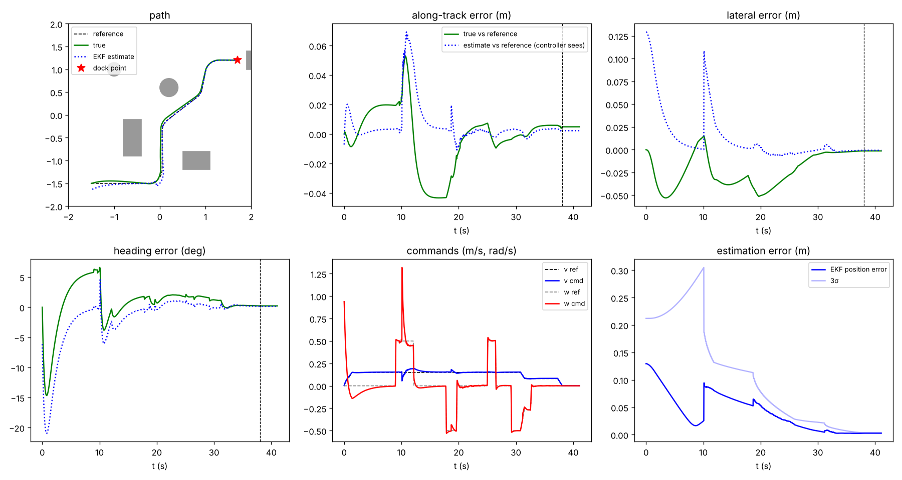

- The controller uses only the EKF estimate. With a wrong initial estimate it tracks the wrong pose until the marker is seen at about 10 s, so the true robot drifts up to 5 cm off the path; once the EKF corrects, the controller brings it back and it docks within 5 mm.
- A first version capped forward speed at the cruise speed. Because the wheels reach about 97% of the commanded speed, the robot fell behind and could not catch up (along-track RMSE 0.035 m). Capping at the robot's top speed, 0.26 m/s, reduced it to 0.009 m.

## Integration

### State machine

| State | Behaviour | Leaves when |
|---|---|---|
| NAVIGATE | LQR tracks the reference | reference enters the last 0.5 m → DOCK |
| DOCK | slow final approach; needs a marker fix within 1 s while the marker is more than 0.3 m away | no fix → ACQUIRE; reference finished and robot still for 1 s → DONE |
| ACQUIRE | stops and turns towards the estimated marker bearing (ω = 1.0 β, max 0.3 rad/s) | fix accepted → DOCK; 15 s → ABORT |
| DONE / ABORT | stopped | |

The reference clock only advances while the robot is allowed to move, so the target waits during LiDAR stops and ACQUIRE. Below 0.3 m the marker no longer fits in the image (702 px tall at the docking point), so the robot finishes on its estimate. While docking, the LiDAR limit uses 0.12 / 0.25 m because the dock wall is expected ahead. At DONE the robot judges success from its own estimate (within 3 cm and 3°).

### Robustness

| Problem found | Cause | Fix |
|---|---|---|
| False marker id 17 | floor reflections decoded as a marker | ignore ids not in the marker map |
| NaN commands | solvePnP returned NaN at the image edge | drop non-finite detections |
| Closed-loop NEES 14.7 | camera update applied before the predict step (20 ms stale estimate) | predict first; NEES 2.06 |
| Gate lockout after a push | every measurement rejected as an outlier | 10 rejections in a row → add σ = 0.30 m, 0.30 m, 20° to P |
| Stuck in DOCK with the marker out of view | robot stopped where the marker was cut off | ACQUIRE state |

### Scenarios

| Scenario | Disturbance |
|---|---|
| odom_bias | left encoder reads 1% high (2.0° per metre heading drift) |
| push | 18 N sideways for 0.3 s at t = 15 s (about 10 cm slide, 9° turn) |
| occlusion | camera blind from t = 24 s to 32 s |
| all | all three |

### Results

Output of `python run.py --scenario <name>`. Docking error is the true final pose against (1.70, 1.20, 0°).

| Scenario | Time | Lateral RMSE (max) | Heading RMSE | Estimation RMSE | NEES after first fix | Relocalised | Docking error |
|---|---|---|---|---|---|---|---|
| nominal | 39.0 s | 0.005 m (0.009) | 0.23° | 0.006 m | 2.06 | – | 0.004 m, -0.06° |
| odom_bias | 39.9 s | 0.013 m (0.033) | 1.63° | 0.017 m | 13.94 | 2 | 0.005 m, +0.27° |
| push | 39.0 s | 0.032 m (0.120) | 2.88° | 0.033 m | 22.61 | 1 | 0.004 m, -0.13° |
| occlusion | 39.6 s | 0.005 m (0.009) | 0.81° | 0.007 m | 2.02 | – | 0.004 m, +0.14° |
| all | 40.6 s | 0.025 m (0.097) | 3.67° | 0.030 m | 54.36 | 2 | 0.005 m, +0.21° |

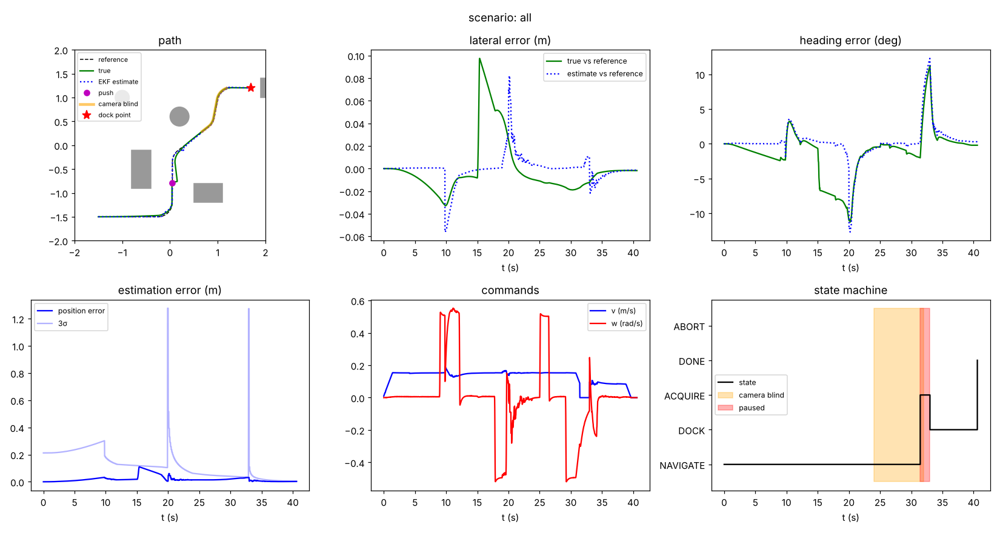

All five scenarios dock within 5 mm. NEES is close to 3 when the filter's assumptions hold and high under the push and encoder bias, which the process noise does not model; relocalisation recovers the estimate when the camera disagrees for 1 s. Results differ by about a millimetre between machines because camera rendering and OpenCV builds differ slightly.

## Evaluation

### Repeated trials

10 randomised trials per scenario (`analysis/trials.py`). Each seed draws the initial estimate error (σ = 5 cm, 5 cm, 3°) and LiDAR noise, and varies the disturbance: encoder bias 0.5–1.5% on either wheel, push at t = 12–18 s towards +x or −x, blind window starting at t = 20–26 s. Success = DONE with true docking error under 3 cm and 3°. Every row of `analysis/results/trials.csv` records its seed and disturbance settings.

| Scenario | Success | Docking error | Docking heading | Est. RMSE | Median NEES | Relocalisations |
|---|---|---|---|---|---|---|
| nominal | 10/10 | 3.9 ± 0.1 mm | 0.14 ± 0.11° | 43 ± 14 mm | 2.00 | 0.0 |
| odom_bias | 10/10 | 5.0 ± 0.7 mm | 0.24 ± 0.15° | 46 ± 13 mm | 20.2 | 1.6 |
| push | 10/10 | 3.9 ± 0.1 mm | 0.13 ± 0.07° | 57 ± 12 mm | 66.6 | 1.0 |
| occlusion | 10/10 | 3.9 ± 0.1 mm | 0.16 ± 0.11° | 43 ± 14 mm | 1.74 | 0.0 |
| all | 10/10 | 7.7 ± 2.8 mm | 0.71 ± 0.61° | 55 ± 12 mm | 52.7 | 1.9 |

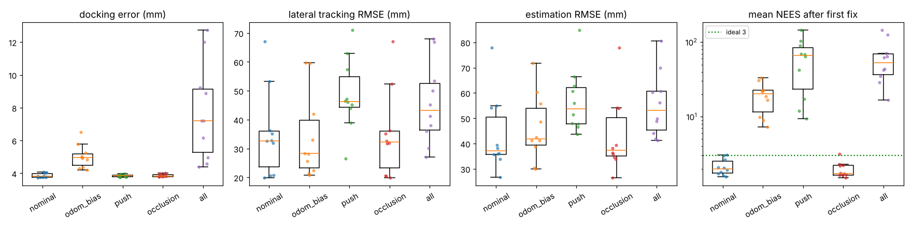

- 50 of 50 trials docked; the worst was 12.7 mm and 1.83° with all disturbances together.
- The nominal docking error is systematic (3.9 ± 0.1 mm): the robot stops slightly short as the reference slows to zero.
- Estimation RMSE is over the whole run and is dominated by the deliberate initial error, which is only corrected once the marker is seen at about 10 s.
- 10 trials per scenario cannot rule out a failure rate of about 10%.

### Trade-offs

`analysis/sweeps.py`, 3 seeds per setting, all 39 runs docked.

LQR effort weight R (push scenario):

| R scale | Docking error | RMS speed correction | Peak wheel speed | Lateral RMSE (true) |
|---|---|---|---|---|
| × 0.25 | 2.6 mm | 0.0091 m/s | 7.58 rad/s | 34 ± 7 mm |
| × 0.5 | 3.2 mm | 0.0078 m/s | 7.47 rad/s | 29 ± 9 mm |
| × 1 (used) | 3.8 mm | 0.0063 m/s | 7.47 rad/s | 28 ± 3 mm |
| × 2 | 5.2 mm | 0.0059 m/s | 7.24 rad/s | 32 ± 4 mm |
| × 4 | 7.2 mm | 0.0048 m/s | 7.14 rad/s | 29 ± 3 mm |

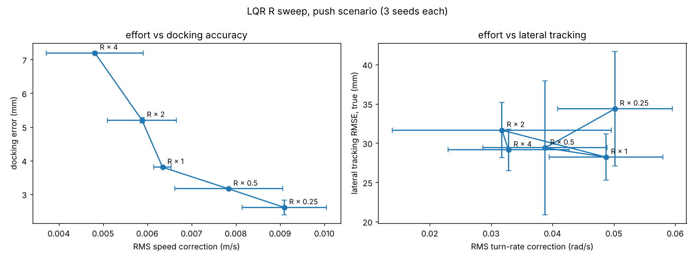

Lower R reduces the docking error at the cost of more correction effort and wheel speeds closer to the 7.88 rad/s limit. Lateral tracking does not change with R: the remaining true error is estimation error, so tracking is estimation-limited.

EKF noise settings:

| R inflation (nominal) | Mean NEES | Est. RMSE |
|---|---|---|
| 1× | 11.1 | 28 mm |
| 2× | 3.26 | 25 mm |
| 3× (used) | 2.43 | 24 mm |
| 5× | 1.11 | 23 mm |

| Wheel noise k (encoder bias) | Mean NEES | Est. RMSE | Relocalisations |
|---|---|---|---|
| 0.01 | 38.8 | 27.5 mm | 2 |
| 0.02 (used) | 14.1 | 27.2 mm | 2 |
| 0.05 | 3.49 | 25.0 mm | 0 |
| 0.10 | 1.63 | 25.0 mm | 0 |

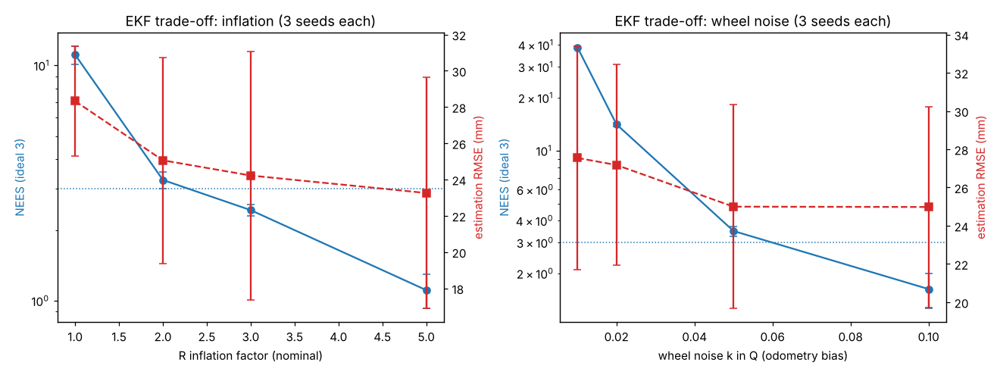

NEES crosses the ideal value of 3 between R inflation 2× and 3×, and at a wheel noise of about k = 0.05. With k = 0.05 the filter stays consistent under a 1% encoder bias without relocalising; on the nominal case it gives NEES 1.35 with the same estimation error (24.1 vs 24.2 mm) and docking error (3.8 vs 3.9 mm).

## Acknowledgements

- TurtleBot3 Waffle Pi MJCF model and meshes: ROBOTIS, Apache 2.0 (`models/turtlebot3/`, unmodified; changes are in `models/tb3_robot.xml`).
- Simulation: MuJoCo. Marker detection and pose: OpenCV ArUco and `solvePnP` (IPPE_SQUARE).
- The discrete Riccati equation is solved with the structure-preserving doubling algorithm, checked against SciPy's `solve_discrete_are`.
