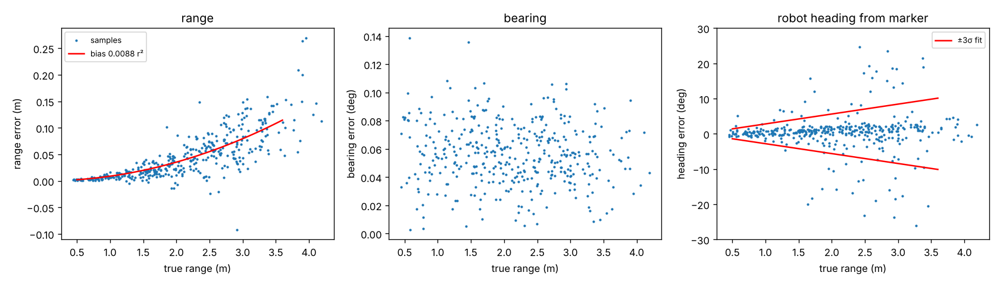
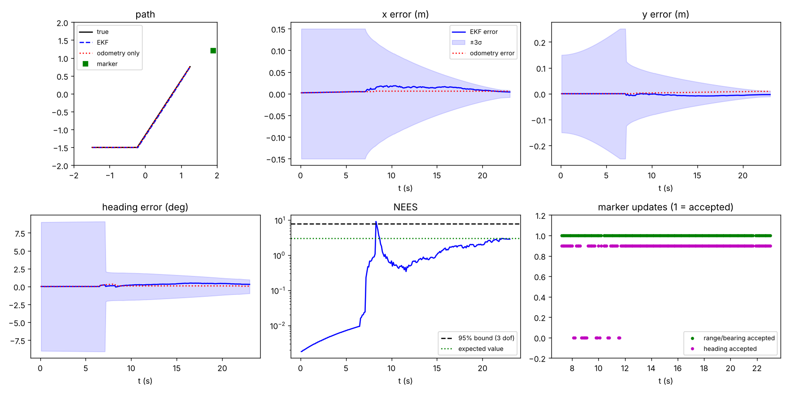
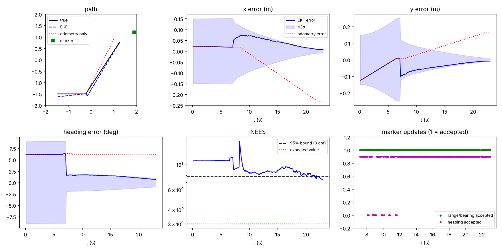

# 41014 Integrated Project

Track A: mobile robot visual waypoint navigation. A TurtleBot3 Waffle Pi in MuJoCo navigates a room with obstacles using its 2D LiDAR and docks at an ArUco-marked charging station. The pipeline is a state-space model of the platform, an EKF fusing wheel-encoder odometry with camera measurements of the marker, and an LQR trajectory tracker that uses only the estimated state.


## Group Information

Project number: 38

| Name | Student ID |
|---|---|
| Benedict Valdez | 25470271 |
| Jacob Jung | 25469949 |

## Install Info

Tested with Python 3.10 or newer.

```
git clone https://github.com/benedictavaldez-ai/41014-Integrated-Project.git
cd 41014-Integrated-Project
python -m venv .venv
```

Activate the environment:

- Windows: `.venv\Scripts\activate`
- macOS / Linux: `source .venv/bin/activate`

Then install the dependencies:

```
pip install -r requirements.txt
```

## Run Commands

Sensor smoke test with the MuJoCo viewer (drives an open-loop path and prints encoder, LiDAR and ArUco readings):

```
python main.py
```

Same test without the viewer:

```
python main.py --headless
```

Controllability and observability check:

```
python analysis/model_check.py
```

Marker measurement noise study (writes `docs/marker_noise.png`):

```
python analysis/marker_noise.py
```

EKF test on the open-loop path (writes `docs/ekf_open_loop.png`):

```
python analysis/ekf_open_loop.py
```

Same test with a random initial estimate error (writes `docs/ekf_open_loop_init_seed3.png`):

```
python analysis/ekf_open_loop.py --init-error --seed 3
```

## Repository Structure

```
models/
  turtlebot3/        unmodified ROBOTIS TurtleBot3 MJCF and meshes (Apache 2.0)
  tb3_robot.xml      Waffle Pi with camera, LiDAR site and wheel encoders added
  world.xml          room, obstacles, charging dock with ArUco marker
  textures/          ArUco marker image (DICT_4X4_50, id 0)
src/
  perception/        LiDAR ray-cast scanner, ArUco detection and pose,
                     wheel encoders, marker measurement and noise model
  estimation/        EKF
  control/           LQR tracker and docking (step 3)
analysis/            model checks, sensor calibration and EKF evaluation
                     (the only code that reads simulator ground truth)
main.py
```

## Simulation Setup

| Item | Value |
|---|---|
| Room | 4 m x 4 m, walls 0.5 m high, four obstacles |
| Start pose | (-1.5, -1.5, 0) |
| Charging dock | marker centre at (1.899, 1.2, 0.13), facing -x, docking point at (1.70, 1.2) |
| Physics timestep | 2 ms |
| Wheel motors | velocity actuators, kv = 1, limit ±7.88 rad/s |
| Camera | 640 x 480, vertical FOV 48.8°, 0.086 m ahead of the wheel axle, 0.107 m high |
| LiDAR | 360 beams, 0.12 to 3.5 m, 0.172 m high, σ = 0.01 m |
| Encoders | wheel joint angle quantised to 4096 ticks/rev (Dynamixel XM430), read every 20 ms |

Changes made to the ROBOTIS model, and why:

- The chassis collision mesh touches the floor and was dragging with full friction, so the robot only reached about 50% of the commanded speed and could not turn in place. The chassis contact is now frictionless (it behaves like the real ball casters).
- The wheel velocity gain was raised from 0.1 to 1. With 0.1 the wheels reached only about 75% of the commanded speed because of joint friction. With 1 they reach about 97%.
- The original model has no camera, LiDAR or encoder sensors, so these were added at the positions of the real Raspberry Pi camera and LDS-01.

## Model

State and input:

$$x = \begin{bmatrix} p_x & p_y & \theta \end{bmatrix}^T, \qquad u = \begin{bmatrix} v & \omega \end{bmatrix}^T$$

Differential-drive kinematics (unicycle), with wheel radius r = 0.033 m and wheel separation b = 0.288 m:

$$\dot p_x = v\cos\theta, \quad \dot p_y = v\sin\theta, \quad \dot\theta = \omega$$

$$v = \frac{r(\omega_R + \omega_L)}{2}, \qquad \omega = \frac{r(\omega_R - \omega_L)}{b}$$

Assumptions: no wheel slip, flat floor, motor dynamics fast compared with the controller. The smoke test confirms the first and third: commanding v = 0.15 m/s gives 0.146 m/s, and commanding ω = 0.5 rad/s gives 0.474 rad/s with wheel speeds that match the kinematics exactly.

Discrete-time model used by the EKF (Euler, Δt):

$$x_{k+1} = x_k + \Delta t \begin{bmatrix} v_k\cos\theta_k \\ v_k\sin\theta_k \\ \omega_k \end{bmatrix}, \qquad F_k = \begin{bmatrix} 1 & 0 & -v_k\Delta t\sin\theta_k \\ 0 & 1 & v_k\Delta t\cos\theta_k \\ 0 & 0 & 1 \end{bmatrix}$$

Tracking-error model used by the LQR, linearised about a reference (v_r, ω_r) with the error expressed in the robot frame:

$$\dot e = \begin{bmatrix} 0 & \omega_r & 0 \\ -\omega_r & 0 & v_r \\ 0 & 0 & 0 \end{bmatrix} e + \begin{bmatrix} 1 & 0 \\ 0 & 0 \\ 0 & 1 \end{bmatrix} \delta u$$

### Controllability

Output of `python analysis/model_check.py`:

| Reference | Rank of controllability matrix |
|---|---|
| v_r = 0.2, ω_r = 0 | 3 (controllable) |
| v_r = 0.2, ω_r = 0.5 | 3 (controllable) |
| v_r = 0, ω_r = 0.5 | 3 (controllable) |
| v_r = 0, ω_r = 0 | 2 (not controllable) |

When the reference is stationary, the linearised model cannot correct sideways error, because the robot cannot move sideways. The tracker therefore always follows a moving reference, and the final docking alignment is done by driving through a path rather than by regulating to a point.

### Observability

| Measurement | Rank of observability matrix |
|---|---|
| Wheel odometry only | 0 (absolute pose unobservable, error grows without bound) |
| Range + bearing to one marker, any motion | 2 |
| Full marker pose from PnP, one frame | 3 |

Range and bearing to a single landmark leave one direction unobservable: rotating the robot's whole path about the marker produces identical measurements. The EKF therefore uses the full marker pose from PnP (which also gives heading), or range and bearing to two or more markers.

## Sensing

### Marker measurement

Each ArUco detection gives the EKF three numbers, z = [range, bearing, robot heading]:

- Range and bearing come from the PnP translation: range = |t|, bearing = -atan2(t_x, t_z).
- Robot heading comes from the full marker pose, chained through the frames:

$$T_{world,base} = T_{world,marker} \cdot T_{cam,marker}^{-1} \cdot T_{base,cam}^{-1}$$

Frames: world (x east, y north, z up), base (x forward, y left, z up, origin at the wheel axle), camera (OpenCV: x right, y down, z forward, 0.086 m ahead and 0.107 m above the base), marker (x right, y up, z out of the face). The camera transform was checked against MuJoCo's camera pose numerically.

### Calibration

Output of `python analysis/marker_noise.py`: 400 random poses facing the marker, detector output compared with simulator ground truth (0.45 to 4.2 m).

| Quantity | Bias | Noise (std) | Value used in the EKF |
|---|---|---|---|
| Range | reads long by 0.0088 r² | 0.0042 r² | bias removed with k = 0.009, σ = 0.005 r² |
| Bearing | +0.056° | 0.022° | σ = 0.1° |
| Robot heading from PnP | none | 0.94° per m (robust); 11% of readings off by more than 10° | σ = max(1°, 0.9° r), own gate |



- Range error grows with r² because range comes from the marker's size in pixels (w = fL / r). The fit corresponds to a corner error of about 0.33 px.
- The bearing offset is half a pixel, from the principal point at 320 px instead of 319.5 px.
- Heading is poorly defined at range and suffers from the planar PnP ambiguity (two tilts fit a face-on square almost equally well), which causes the 10 to 30° outliers.
- Ground truth is used here only for offline calibration. The filter uses the resulting constants and never reads ground truth at run time.

## Estimation

### EKF design

| Item | Value |
|---|---|
| State | x = [p_x, p_y, θ] |
| Prediction | encoder wheel-angle changes every 20 ms, midpoint unicycle model |
| Process noise | per wheel σ = 0.02 \|Δφ\| + 10⁻⁴ rad, mapped to the state through the wheel Jacobian |
| Update | every 100 ms when a marker is detected: range + bearing first, then heading as a separate update |
| Measurement noise | calibration values above × 3 |
| Gates | NIS < 9.21 for range + bearing (χ², 2 dof, 99%), NIS < 6.63 for heading (1 dof, 99%) |
| Covariance update | Joseph form |
| Initial covariance | σ = 0.05 m, 0.05 m, 3° |

Range and bearing are accurate, heading is not, so they are updated separately: a rejected heading does not discard a good range and bearing.

### Measurement noise inflation

With the calibrated noise the filter was overconfident, because consecutive frames see almost the same image and their errors are correlated rather than independent. R was inflated and the factor chosen on NEES over 6 seeded runs with a random initial error:

| Inflation | Mean NEES (ideal 3) | Position RMSE | Heading RMSE |
|---|---|---|---|
| 1× | 15.6 | 0.039 m | 0.83° |
| 2× | 5.3 | 0.033 m | 0.71° |
| 3× (used) | 3.5 | 0.032 m | 0.65° |

### Results on the open-loop path

Output of `python analysis/ekf_open_loop.py` (with and without `--init-error`). The marker is first seen at t = 7.5 s.

| Run | Final position error | Final heading error | Position RMSE | Mean NEES |
|---|---|---|---|---|
| Nominal, EKF | 0.005 m | +0.30° | 0.012 m | 1.08 |
| Nominal, odometry only | 0.011 m | +0.05° | | |
| Initial error (seed 3), EKF | 0.011 m | +0.70° | 0.067 m | 9.41 |
| Initial error (seed 3), odometry only | 0.282 m | +6.17° | | |
| Initial error, mean of 6 seeds, EKF | 0.007 m | | 0.032 m | 3.47 |





- Simulated odometry is close to perfect (11 mm drift over about 7 m), so the nominal run shows little difference between EKF and odometry. The initial-error run shows the correction: odometry keeps a 6.2° heading error and drifts 28 cm, the EKF ends at 1.1 cm and 0.7°.
- All range and bearing updates pass the gate. 9% of heading updates are rejected, all at long range.
- Seed 3 starts with a 6° heading error (a 2σ draw) and its heading converges slowly, sitting at the edge of the 3σ band for about 10 s. With a single marker, heading is weakly observable and the heading reading is noisy at 3 m.
